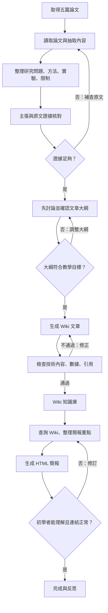

# Loop / Graph 設計

## 會重複的步驟
- 證據不足時回到原文抽取與核對。
- 大綱不符合教學目標時重新討論。
- 文章出現技術錯誤或引用不足時回到文章修訂。
- 簡報難以理解或頁面過度擁擠時，回到 Wiki 查詢與重點整理。
## 為什麼這樣設計？
把證據檢查放在文章生成前，可以避免錯誤資訊進入 Wiki；文章完成後再檢查一次，則可避免簡報引用到錯誤內容。流程保留簡單的回退迴圈，容易說明，也足以呈現資訊如何取得、整理、檢查與生成。
